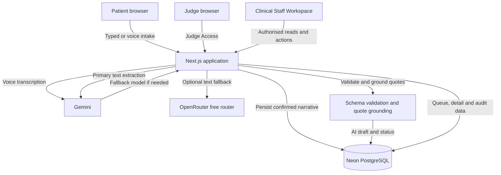

# MedFlow

**Voice-first, AI-assisted patient intake with evidence-linked clinical review.**

MedFlow helps patients describe what brings them to a clinic using speech or text, preserves the patient's confirmed statement, prepares an AI-assisted structured summary with source quotations, and gives clinical staff a focused queue for human review and workflow management.

**Competition:** TCC Hackathon 2026  
**Product status:** Hackathon demonstration prototype  
**Live application:** https://medflow-seven-tau.vercel.app  
**Judge Access:** https://medflow-seven-tau.vercel.app/demo  
**Patient Intake:** https://medflow-seven-tau.vercel.app/intake

> **Synthetic-data-only demonstration.** Do not enter real patient information or audio. MedFlow is not clinically validated, is not an emergency service, and must not be used to make real patient-care decisions. It does not diagnose, prescribe, independently determine clinical urgency, or tell anyone that it is safe to wait. Clinical staff retain control of review priority and workflow decisions.

---

## Try MedFlow

The hackathon experience is designed around one simple path for judges:

1. Open [Judge Access](https://medflow-seven-tau.vercel.app/demo).
2. Select **Enter Clinical Workspace**.
3. Review the patient queue at `/staff/queue`.
4. Open an intake to inspect the patient's confirmed statement, AI-assisted summary and supporting quotations.
5. Use the available staff review, correction, priority and workflow actions.

No Google Sign-In or manual account provisioning is required for the judge journey. The demo session is created through the server-controlled, signed Clinical Staff demo flow.

Patients can open [Patient Intake](https://medflow-seven-tau.vercel.app/intake) directly. The patient flow does not require an account.

---

## The problem

At clinic check-in, patients often describe their concerns in everyday language. Staff must capture the account, clarify missing information and organise it for review while managing an active intake queue.

MedFlow focuses on that first information handoff. It is not a full hospital management system and does not automate clinical decisions.

## How it works

1. **Patient tells their story.** The patient types or records a short voice statement.
2. **Patient reviews the words.** Voice transcription is presented for editing and explicit confirmation before submission.
3. **MedFlow saves the statement.** The confirmed narrative is stored separately from the raw voice transcript, with a SHA-256 integrity value and an intake reference.
4. **AI prepares a draft.** Gemini is the primary text-extraction provider. A Gemini fallback model is attempted before the optional OpenRouter free-model fallback.
5. **Evidence checks run.** Extracted source quotations are checked against the exact confirmed narrative. Unsupported quotations are removed or the affected item is marked unclear.
6. **Clinical staff review.** Staff inspect the original statement and AI draft, correct the draft where needed, and control priority and workflow status.
7. **Actions are audited.** Patient submission, AI processing and staff workflow actions are recorded in the activity history.

## Implemented capabilities

| Area | Current implementation |
|---|---|
| Patient intake | Guided, multi-step mobile-first flow with optional name and age |
| Input methods | Typed narrative and browser voice recording |
| Voice transcription | Server-side Gemini transcription; editable transcript; raw and confirmed text kept separately |
| Persistence | Neon PostgreSQL intake persistence, reference codes, idempotency and audit events |
| AI extraction | Gemini primary, Gemini fallback model, optional OpenRouter free-model fallback for text extraction |
| Output validation | Runtime schema validation before AI output is stored or displayed |
| Evidence grounding | Exact-substring quote checks against the confirmed narrative; unsupported quotations are removed or demoted |
| Clinical workspace | Clinical Staff queue, intake detail, review, correction, staff-assigned priority and workflow status |
| Accountability | Append-only audit events for patient, system and staff actions |
| Judge access | One-click server-signed Clinical Staff demo session |

AI extraction is non-authoritative. A successful quote match verifies that a quotation occurs in the patient's statement; it does not prove the interpretation is clinically correct.

### Evidence Integrity Engine: implementation boundary

The current application includes deterministic runtime quote grounding in `src/lib/gemini/service.ts`, including `groundBriefQuotesAgainstNarrative`. It also stores the confirmed narrative hash and displays supporting quotations for staff review.

The full advanced EIE specification includes persisted field-level evidence records, source spans, provenance envelopes and HMAC signing/verification. Those advanced Milestone 3 capabilities are **not represented as complete** in this repository. The presence of the `intake_evidence` database schema does not mean every extraction currently writes a field-level evidence record or HMAC envelope.

---

## Technology stack

- **Application:** Next.js App Router, React and TypeScript
- **UI:** Reusable React components and CSS aligned to the MedFlow HTML design-system reference
- **Server:** Next.js Route Handlers running on the Node.js runtime
- **Database:** Neon PostgreSQL
- **Database access:** `pg`, Drizzle ORM and Drizzle Kit
- **Authentication and demo access:** Firebase Authentication for the retained staff identity integration; server-signed HTTP-only demo sessions for hackathon Judge Access
- **Primary AI provider:** Google Gemini via `@google/genai`
- **Text extraction fallback:** OpenRouter `openrouter/free` using its OpenAI-compatible API
- **Validation:** Zod
- **Icons:** Lucide React
- **Deployment:** Vercel

### Architecture



All AI provider calls and database access happen server-side. Browser clients do not receive Gemini or OpenRouter API keys or database credentials.

---

## Repository structure

```text
medflow/
├── README.md
├── AGENTS.md
├── AI_STUDIO_MASTER_PROMPT.md
├── CONTRIBUTING.md
├── SECURITY.md
├── .env.example
├── firebase-applet-config.json
├── drizzle/                  # SQL migrations and Drizzle metadata
├── docs/                     # Product, rules, architecture, safety and delivery docs
├── public/                   # Static assets and design references
└── src/
    ├── app/                  # Pages and API Route Handlers
    ├── components/           # Patient, staff, home, layout and UI components
    ├── db/                   # Database schema, migrations, seed and verification
    └── lib/                  # AI providers, APIs, auth, validation and repositories
```

Important documentation:

- [Hackathon rules and scorecard](docs/01_HACKATHON_RULES_AND_SCORECARD.md)
- [Product definition](docs/02_PRODUCT_DEFINITION.md)
- [Clinical safety and privacy](docs/07_CLINICAL_SAFETY_AND_PRIVACY.md)
- [Technical architecture](docs/08_TECHNICAL_ARCHITECTURE.md)
- [Data model and API contracts](docs/09_DATA_MODEL_AND_API_CONTRACTS.md)
- [Testing and demo plan](docs/10_TESTING_AND_DEMO_PLAN.md)
- [Repository and judge readiness](docs/12_REPOSITORY_AND_JUDGE_READINESS.md)
- [Sprint log and AI disclosure](docs/17_SPRINT_LOG_AND_AI_DISCLOSURE.md)
- [Evidence Integrity Engine specification](docs/19_EVIDENCE_INTEGRITY_ENGINE_SPEC.md)
- [Security specification](security_spec.md)

---

## Run locally

### Prerequisites

- Bun (the repository includes `bun.lock`)
- Node.js compatible with the installed Next.js version
- A Neon PostgreSQL database
- A Gemini API key for voice transcription and primary extraction
- An OpenRouter API key for the optional text-extraction fallback
- A configured synthetic demo facility and demo session secret

### Install and configure

```bash
bun install
cp .env.example .env.local
```

Edit `.env.local` with valid values for the environment you are using. Never commit `.env.local` or any real secret.

### Database setup

```bash
bun run db:migrate
bun run db:seed
```

- `DATABASE_URL` is the pooled runtime connection.
- `DATABASE_URL_UNPOOLED` is used for direct migration and seed operations.
- The seed operation provisions the canonical synthetic demo facility and its demo staff records. It is designed to be idempotent.

### Start development

```bash
bun run dev
```

Open http://localhost:3000.

### Quality checks

```bash
bun run typecheck
bun run test
bun run lint
bun run build
```

The live Neon verification tests use `DATABASE_URL` or `DATABASE_URL_UNPOOLED`. When no database URL is configured, those live database tests are skipped; a passing local test run without database configuration is not a substitute for live database verification.

---

## Environment configuration

Use `.env.example` as the authoritative variable-name template. The following server variables are relevant to the deployed hackathon experience:

| Variable | Required for | Notes |
|---|---|---|
| `DATABASE_URL` | Runtime database access | Pooled Neon PostgreSQL connection |
| `DATABASE_URL_UNPOOLED` | Migration and seed commands | Direct Neon connection |
| `GEMINI_API_KEY` | Gemini extraction and voice transcription | Server-only secret |
| `OPENROUTER_API_KEY` | Optional text-extraction fallback | Server-only secret; the fallback is not used for audio |
| `MEDFLOW_DEMO_MODE_ENABLED` | Judge Access | Must be `true` on the intended demo deployment |
| `MEDFLOW_DEMO_SESSION_SECRET` | Judge Access session signing | Server-only random secret, at least 32 characters |
| `MEDFLOW_DEMO_SESSION_TTL_SECONDS` | Demo session lifetime | Optional; default is 7200 seconds |
| `NEXT_PUBLIC_DEMO_FACILITY_PUBLIC_CODE` | Public intake facility mapping | Defaults to `DEMO-CLINIC-01` |
| `GEMINI_EXTRACTION_MODEL` | Gemini text extraction | Optional model override |
| `GEMINI_TRANSCRIBE_MODEL` | Voice transcription | Optional model override |
| `MAX_AUDIO_UPLOAD_BYTES` | Audio upload limit | Optional; default is 10 MiB |
| `MAX_AUDIO_DURATION_SECONDS` | Recording duration limit | Optional; default is 90 seconds |

Do not put server credentials in `NEXT_PUBLIC_*` variables. The tracked `firebase-applet-config.json` contains browser-side Firebase configuration, not Firebase Admin service-account credentials; review the Firebase API-key restrictions and authorised domains for the deployed application.

### Vercel deployment

Configure the required production variables in the Vercel project settings. In particular, verify:

- `DATABASE_URL`
- `GEMINI_API_KEY`
- `OPENROUTER_API_KEY` (when fallback is enabled)
- `MEDFLOW_DEMO_MODE_ENABLED=true`
- `MEDFLOW_DEMO_SESSION_SECRET`
- `NEXT_PUBLIC_DEMO_FACILITY_PUBLIC_CODE=DEMO-CLINIC-01`

After changing environment variables, create a new deployment. A successful Vercel build/status check does not by itself prove that live database writes, Gemini calls or OpenRouter fallback work at runtime.

---

## Privacy and clinical limitations

- Use synthetic names, ages, narratives and voice recordings only.
- Do not use MedFlow for real patient care or emergencies.
- Do not enter real patient data or audio.
- AI summaries are drafts for human review, not diagnoses or clinical recommendations.
- AI does not assign clinical priority or workflow status.
- Staff actions remain separate from the original patient narrative and AI draft.
- Voice recordings are processed for transcription and are not intended to be stored as raw audio.
- OpenRouter is an external model-routing service. Use only synthetic demonstration content with the fallback. Provider availability, model selection, rate limits and data handling can vary.
- Quote grounding establishes textual source matching, not clinical truth.
- A real-world pilot would require clinical governance, validation, privacy/security review, vendor review and applicable regulatory assessment.

See [SECURITY.md](SECURITY.md) and [Clinical Safety and Privacy](docs/07_CLINICAL_SAFETY_AND_PRIVACY.md).

---

## TCC Hackathon work and AI disclosure

The participant guide requires the README to distinguish work completed during the official November 22–24 sprint from any pre-existing planning or assets. The implementation history and tool contributions are recorded in [docs/17_SPRINT_LOG_AND_AI_DISCLOSURE.md](docs/17_SPRINT_LOG_AND_AI_DISCLOSURE.md). The team should review that log against Git history before the final public submission and correct any dates or contributors that are inaccurate.

AI assistance used in the project includes:

- **Google AI Studio Build / Gemini:** application implementation, refactoring, debugging and test authoring.
- **OpenAI ChatGPT:** product planning, implementation prompts, documentation, repository review and submission preparation.
- **Gemini API:** runtime voice transcription and primary clinical-context extraction.
- **OpenRouter:** optional runtime text-extraction fallback after Gemini attempts.

List any additional tools used by team members in the sprint disclosure, with their actual contributions. Do not claim that AI tools independently establish clinical validation.

---

## Submission status

The TCC participant guide requires a public source repository, a publicly accessible product demonstration video of **4:50–5:10**, and one official form submission. The video must demonstrate the real application, be publicly viewable, tag Tech Conference Calabar and include:

- `#CTCHackathon2026`
- `#TechConferenceCalabar`

The official form is distributed through the organisers' WhatsApp group. Confirm the current form and instructions with the team lead before submission. See [docs/01_HACKATHON_RULES_AND_SCORECARD.md](docs/01_HACKATHON_RULES_AND_SCORECARD.md) and [docs/FINAL_SUBMISSION_READINESS.md](docs/FINAL_SUBMISSION_READINESS.md).

---

## Project status and ownership

MedFlow is a working hackathon prototype and a working codename, not a cleared commercial brand. No clinical-validation, hospital-adoption, patient-outcome or production-care claims are made.

No software licence file is currently included. Public repository visibility for judging does not, by itself, grant permission to reuse or redistribute the code.
