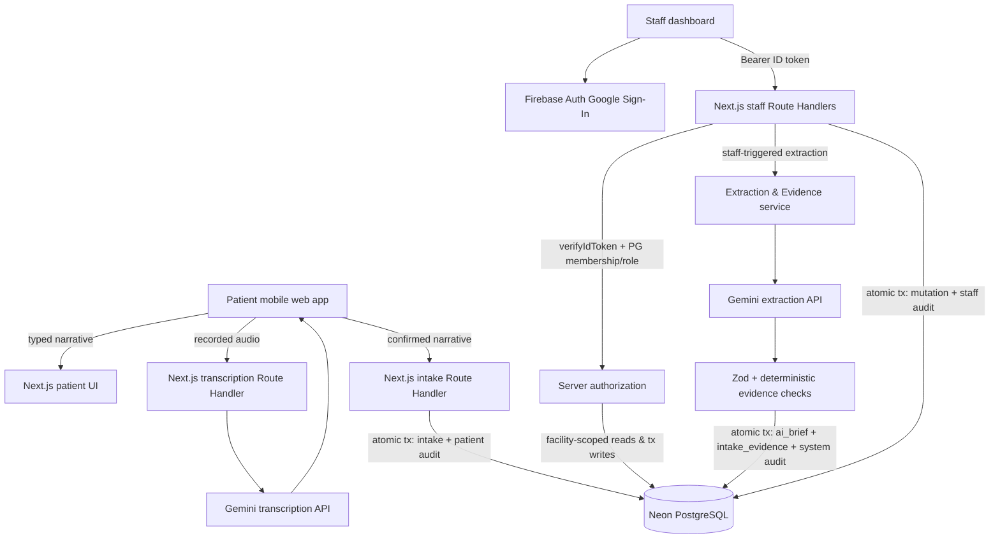

# MedFlow — Technical Architecture (Hackathon Baseline)

## 1. Architecture objective

Build a small, understandable full-stack **Next.js application** that supports the patient-to-clinician workflow, can be inspected in GitHub and can be deployed reliably. Keep the design commercially sensible without introducing microservices or unnecessary infrastructure.

## 2. Approved technology decisions

The application framework is **Next.js with the App Router**. This is an explicit project requirement, not an optional recommendation.

| Layer | Approved choice | Implementation boundary |
|---|---|---|
| Framework | **Next.js App Router** | One Next.js application; do not replace with Vite, plain React, or a separate Express app. |
| Language | TypeScript | Strict types for domain objects, API contracts and service boundaries. |
| UI | React Server and Client Components | Use Client Components only where browser interaction/state is required. |
| Styling | Application CSS derived directly from the attached HTML design-system file | Match the attached HTML; do not create a separate design-token file or visual specification. |
| Server/API | **Next.js Route Handlers** under `app/api/**/route.ts` | No separate Express or Python backend for the MVP. |
| Authentication | Firebase Authentication (Google Sign-In + same-origin `/__/auth/*` proxy) | Staff identity is verified server-side via `firebase-admin` `verifyIdToken(token)` (no IAM required). Authentication alone grants zero clinical privileges. |
| Database | **Neon PostgreSQL** (`pg` + Drizzle ORM + Drizzle Kit) — approved via `D-020` | Authoritative relational store for facilities, staff profiles, memberships, patient intakes, evidence rows, and append-only audit events. All reads/writes occur through server-side Next.js Route Handlers. *(Transitional Firestore files remain untouched during Phase 1D-1 until Phase 1D-3 decommissioning.)* |
| Queue updates | Authenticated facility-scoped Route Handlers + visibility-aware polling (Phase 1D-2) | Replaces client-side Firestore `onSnapshot` listeners so no database credentials or direct DB connections ever reach the browser. |
| AI extraction | Google Gemini API, called server-side | Strict schema validation; AI output is a non-authoritative draft triggered and persisted only through an authenticated, authorized staff session (`D-015`). |
| Voice transcription | Gemini audio transcription through the currently supported official API/model | Verify exact model ID, API, audio format and limits from current official docs before implementation. |
| Validation | Zod + PostgreSQL constraints & triggers | Validate every untrusted request and model response at runtime; enforce tenant isolation, immutability, staff-review consistency, and action-to-actor integrity in PostgreSQL. |
| Tests | Node test runner (`node:test`), schema/constraint tests, integration and browser checks | Test business rules, DB invariants, authorization boundaries, and failure states. |
| Deployment target | Google Cloud Run or another verified Node.js host that supports the selected Next.js features | Confirm the actual build and runtime configuration before claiming deployment readiness. |

Do not silently change this stack. If a chosen platform cannot run the required Next.js App Router application or a required server capability, stop and report the exact incompatibility and options. Do not quietly substitute Vite/React, client-only Firebase writes, another backend framework or a different database. Any change requires founder approval and a corresponding documentation decision.

## 3. Google AI Studio and Next.js setup

Google AI Studio Build supports **Next.js** in addition to React and Angular. Google's March 18, 2026 announcement says to select the desired framework from the updated Settings panel. MedFlow must use that selector to choose **Next.js**; do not leave the project on the React default.

Official confirmation: https://blog.google/innovation-and-ai/technology/developers-tools/full-stack-vibe-coding-google-ai-studio/

Before implementation, the agent must:

1. Confirm the imported workspace is in Build Mode and its framework setting is **Next.js**.
2. Inspect the repository. The current GitHub repository is a documentation baseline; it intentionally does not yet contain an application scaffold or `package.json`.
3. Initialise the application as a genuine Next.js App Router + TypeScript project, preserving all existing project documentation. The founder will attach the single HTML design reference directly to the AI Studio conversation.
4. Verify the project uses Next.js scripts/dependencies and App Router files, and that the Build preview executes the Next.js app rather than a plain React/Vite scaffold.
5. Verify Next.js Route Handlers, server-only environment secrets and Node.js runtime behaviour in the actual workspace before relying on them.
6. Verify Firebase Authentication token verification and the Firestore server access pattern in Preview and the intended deployment environment.
7. Record verified setup decisions, any remaining limitations and test evidence in the sprint log.

If the Next.js option is missing from the framework selector or the imported workspace fails to run a genuine Next.js application, report the exact observed limitation and stop before replacing the framework. Do not silently substitute Vite/plain React or create a separate Express/Python backend. Any stack change requires founder approval and a corresponding documentation decision.

The fact that AI Studio offers a server-side Node.js runtime and Firebase integration does not, by itself, prove that every Next.js server feature or Firebase Admin SDK operation works in Preview. Test the specific capabilities used by MedFlow rather than making assumptions.

Official technical references:
- Google AI Studio Build Mode: https://ai.google.dev/gemini-api/docs/aistudio-build-mode
- Google announcement of Next.js support: https://blog.google/innovation-and-ai/technology/developers-tools/full-stack-vibe-coding-google-ai-studio/
- Next.js App Router: https://nextjs.org/docs/app
- Next.js Route Handlers: https://nextjs.org/docs/app/getting-started/route-handlers
- Firebase Admin SDK: https://firebase.google.com/docs/admin/setup
- Firestore Security Rules: https://firebase.google.com/docs/firestore/security/get-started

## 4. Application structure

Use the Next.js App Router. The exact layout may evolve, but keep the following responsibilities clear:

```text
drizzle/
  0000_initial_medflow_schema.sql
  0001_immutability_triggers.sql
  meta/
    _journal.json
    0000_snapshot.json
    0001_snapshot.json
drizzle.config.ts
src/
  db/
    invariants.ts        # Canonical demo facility, 10-action audit actor map, review state helpers
    schema.ts            # Authoritative Drizzle PostgreSQL schema (6 tables, 12 enums, composite FKs, CHECKs)
    index.ts             # Server-only lazy pg.Pool + Drizzle connector (DATABASE_URL)
    seed.ts              # Idempotent founder-run CLI seed script (DATABASE_URL_UNPOOLED)
    schema.test.ts       # Offline schema, trigger, action-to-actor, and invariant tests
  app/
    (patient)/
      intake/
        page.tsx
    (staff)/
      staff/
        login/page.tsx
        queue/page.tsx
        intakes/[intakeId]/page.tsx
    api/
      intakes/route.ts
      intakes/transcribe/route.ts
      intakes/[intakeId]/extract/route.ts
      staff/session/route.ts
      staff/intakes/route.ts
      staff/intakes/[intakeId]/review/route.ts
      staff/intakes/[intakeId]/brief-review/route.ts
      staff/intakes/[intakeId]/priority/route.ts
      staff/intakes/[intakeId]/status/route.ts
    layout.tsx
    globals.css
  components/
    patient/
    staff/
    shared/
  lib/
    env/
    firebase/            # Firebase Auth client + server verifyIdToken (legacy Firestore removed in Phase 1D-3)
    schemas/
```

Keep route handlers thin and move database/domain logic into testable server-only modules. Never import `src/db/*` or `firebase-admin` into Client Components. Do not create a separate `server/` Express application.

## 5. Logical architecture



The diagram describes logical responsibilities under ADR `D-020`. Keep the MVP as one Next.js deployment, Firebase Authentication for staff identity, and one Neon PostgreSQL database. Do not introduce a message broker, vector database, external analytics system or microservice.

## 6. Authentication, authorization and PostgreSQL persistence (`D-020`)

- **Identity vs. authorization:** Firebase Authentication (`daring-brace-jw1xt`, Google Sign-In via same-origin `/__/auth/*` proxy) establishes staff identity only; it never grants clinical or facility access by itself.
- **Server-side verification:** Every protected Next.js Route Handler verifies `Authorization: Bearer <idToken>` using `firebase-admin` `verifyIdToken(token)` (no IAM required), checks `email_verified === true`, and queries PostgreSQL (`staff_profiles` + `facility_memberships` + active `facilities`) to determine active status, role, and permitted `facility_id` values.
- **Authoritative facility scoping:** Derive allowed `facility_id` values exclusively from verified PostgreSQL `facility_memberships` rows. Never trust a client-supplied `facilityId` as proof of access.
- **Zero browser database access:** PostgreSQL connections exist strictly in server-only modules (`src/db/index.ts`, guarded by `assertServerRuntime()`). `DATABASE_URL` and `DATABASE_URL_UNPOOLED` are never prefixed with `NEXT_PUBLIC_` and never serialized to client bundles or responses.
- **Database-enforced clinical safety invariants:**
  1. **Composite tenant foreign keys:** `patient_intakes` defines `UNIQUE (id, facility_id)`. Both `intake_evidence` and `audit_events` reference `patient_intakes (id, facility_id)` with `ON DELETE RESTRICT`, making cross-facility child attachment impossible at the database layer.
  2. **Source-narrative immutability:** Trigger `patient_intakes_immutability_trg` rejects any `UPDATE` touching `confirmed_narrative`, `transcript_raw`, `facility_id`, `reference_code`, `input_mode`, `transcription_status`, `idempotency_key`, `patient_display_name`, `age`, `demo_record`, or `created_at`.
  3. **Evidence immutability:** Trigger `intake_evidence_immutability_trg` rejects every `DELETE` and every `UPDATE` on `intake_evidence` except a strictly controlled one-way `is_current: true -> false` transition with zero other column changes. A partial unique index (`WHERE is_current = true`) ensures at most one active evidence row per `(intake_id, field_path)`.
  4. **Append-only audit log with DB-level action-to-actor enforcement:** Trigger `audit_events_append_only_trg` rejects all `UPDATE` and `DELETE` operations on `audit_events`. `CHECK` constraints enforce `D-007` actor identity rules, the complete 10-action-to-actor mapping (`patient` / `system` / `staff`), and mandatory non-empty `reason` (≥ 3 trimmed chars) on `priority_changed` and `brief_corrected`.
  5. **Staff-review consistency:** `CHECK` constraint `patient_intakes_staff_review_consistency_chk` enforces internal consistency across `staff_review_status`, `staff_reviewed_brief`, `reviewed_by_uid`, `reviewed_at`, and `staff_correction_note`.
- **Canonical synthetic facility:** `demo-clinic-01` / `DEMO-CLINIC-01` (`MedFlow Synthetic Demo Clinic`) is the sole canonical synthetic demo facility (`demo-facility-001` and `DEMO-FACILITY` are retired).

### 6.1 Migration transition status (Milestone 1D — Complete)

- **Phase 1D-1 (Complete — offline foundation):** Installed `pg`, `drizzle-orm`, `@types/pg`, `drizzle-kit`; authored `src/db/schema.ts`, `src/db/invariants.ts`, `src/db/index.ts`, `src/db/seed.ts`, `drizzle.config.ts`; generated SQL migrations `drizzle/0000_initial_medflow_schema.sql` and `drizzle/0001_immutability_triggers.sql`; verified with offline schema, invariant, env, lint, typecheck, and build checks.
- **Phase 1D-2 (Complete — server APIs & UI cutover):** Implemented server-only PostgreSQL staff repository (`src/lib/db/staff-repository.ts`, `src/lib/db/errors.ts`), reusable Firebase ID-token + PostgreSQL RBAC/facility-membership authorization boundary (`src/lib/auth/staff-authorization.ts`), strict staff API contracts (`src/lib/schemas/staff-api.ts`), authenticated Route Handlers (`GET /api/staff/session`, `GET /api/staff/intakes`, `GET /api/staff/intakes/[intakeId]` via `src/lib/api/staff-handlers.ts`), authenticated client wrapper (`src/lib/staff/api-client.ts`), and 5-second visibility-aware queue polling (`src/lib/staff/polling.ts`). Cut over all active staff UI views to same-origin PostgreSQL APIs.
- **Phase 1D-3 (Complete — live Neon cutover & Firestore decommissioning):** Added `src/db/migrate.ts` and `src/db/live-verification.test.ts`; applied Drizzle SQL migrations (`0000_initial_medflow_schema.sql`, `0001_immutability_triggers.sql`) to live Neon PostgreSQL via `DATABASE_URL_UNPOOLED`; ran idempotent `src/db/seed.ts` twice to verify canonical `demo-clinic-01` (`DEMO-CLINIC-01`); verified all 6 tables, all 3 immutability triggers, live PG-01..PG-06 constraint/trigger enforcement (inside a rolled-back transaction), and live pooled `DATABASE_URL` Drizzle reads via `createDrizzleStaffRepository()`. Removed all legacy Cloud Firestore files (`firestore.rules`, `firebase-blueprint.json`, `src/lib/firebase/errors.ts`, `src/lib/firebase/security-rules.test.ts`, `src/components/shared/FirebaseErrorBoundary.tsx`, `src/lib/schemas/staff.ts`), removed `@firebase/eslint-plugin-security-rules`, and refactored `src/lib/firebase/client.ts` / `config.ts` to Firebase Authentication only (preserving Google Sign-In and the same-origin `/__/auth/*` proxy intact). Note: initial staff profile seeding awaits founder-supplied `SEED_ADMIN_*` values per Option 2B (`D-016`).


## 7. Data-flow rules

1. Patient enters typed text or records audio after explicit microphone permission and disclosure.
2. Audio is sent to the Next.js transcription Route Handler after an explicit user action. Process it transiently; do not persist raw audio.
3. Return a transcript draft. Patient can review, edit, re-record or use typed fallback, then explicitly confirm the narrative.
4. Persist the intake before starting AI extraction. Use an idempotency key to prevent duplicate records.
5. A server-side extraction service calls Gemini and validates the result against the versioned schema.
6. Store the original confirmed narrative and AI draft separately. Never overwrite the patient's words.
7. Evidence references must resolve to exact source text or stable transcript spans. Mark missing, unclear and conflicting information explicitly.
8. AI cannot set priority, workflow status, diagnosis or treatment.
9. Staff dashboard reads only the authenticated staff member's facility-scoped queue.
10. Staff reviews/corrects the draft and assigns priority/status. The server validates permission, state transition and reason, then records an audit event.
11. If AI or transcription fails, preserve the intake and surface it to staff with a visible failure/needs-review state.

## 8. API boundaries

Implement the API contracts in `docs/09_DATA_MODEL_AND_API_CONTRACTS.md` as Next.js Route Handlers:

- `GET /api/staff/session` *(implemented in Phase 1D-2)*
- `GET /api/staff/intakes` *(implemented in Phase 1D-2)*
- `GET /api/staff/intakes/[intakeId]` *(implemented in Phase 1D-2)*
- `POST /api/intakes` *(Milestone 2)*
- `POST /api/intakes/transcribe` *(Milestone 2)*
- `POST /api/intakes/[intakeId]/extract` *(Milestone 2)*
- `POST /api/staff/intakes/[intakeId]/review` *(Milestone 2)*
- `POST /api/staff/intakes/[intakeId]/brief-review` *(Milestone 2)*
- `POST /api/staff/intakes/[intakeId]/priority` *(Milestone 2)*
- `POST /api/staff/intakes/[intakeId]/status` *(Milestone 2)*

Route Handlers validate request bodies, authenticate/authorise protected actions, call domain services and return safe response shapes. Do not expose provider errors, stack traces, credentials or database internals. Use the Web Request/Response APIs supported by Next.js Route Handlers. Do not create a parallel Express API.

## 9. Reliability and queue behaviour

- Apply request size, duration and MIME-type limits to audio.
- Use bounded timeouts and retries for provider calls.
- Persist intake before AI processing.
- Make AI processing state visible and recoverable.
- Use idempotency for intake creation and safe bounded retries for extraction.
- Avoid duplicate records when a mobile client retries.
- Keep unassigned priority explicitly visible; never treat it as low priority.
- Sort the active queue deterministically by staff-assigned priority rank, submission timestamp (oldest first), then stable document ID.
- Do not let model output alter queue order or priority.

## 10. Deployment and secrets

- Keep `DATABASE_URL` (pooled Neon runtime connection), `DATABASE_URL_UNPOOLED` (direct Neon connection for Drizzle migrations and `src/db/seed.ts`), and `GEMINI_API_KEY` strictly in server-side environment secrets.
- `EVIDENCE_HMAC_SECRET` is intentionally deferred until **Milestone 3** (Evidence Integrity Engine implementation); do not configure or require it earlier.
- Include `.env.example` with names and safe placeholders only. Never commit `.env`, database credentials, tokens or secrets.
- Verify the chosen Next.js hosting target supports the App Router, Route Handlers, required Node APIs, TLS PostgreSQL connectivity, and server-side environment variables.
- Cloud Run is a candidate deployment target, not a claim of completed deployment. Verify the actual build/start commands and runtime.
- Confirm the deployed origin uses HTTPS for microphone access.
- Add the microphone permission declaration to `metadata.json` if required by the current AI Studio Build environment.
- Test the deployed URL on a real target Android phone/browser.

## 11. Build verification

Before calling the architecture implemented, verify:

- The project is genuinely Next.js App Router (including `next` dependency, `app/` routes and working Next.js scripts).
- A production build completes.
- Next.js Route Handlers run in the target environment.
- Firebase ID token verification and PostgreSQL facility/role authorization work server-side.
- PostgreSQL schema constraints, composite foreign keys, immutability triggers, and action-to-actor rules are verified.
- Gemini requests execute server-side with secrets unavailable to the browser.
- Voice capture/transcription, transcript confirmation and typed fallback work end-to-end.
- Failure paths preserve intake data and staff visibility.
- The critical tests in `docs/10_TESTING_AND_DEMO_PLAN.md` pass.

A React interface generated by AI Studio is not evidence that the Next.js architecture has been implemented.


### 6.2 Evidence Integrity Engine boundary (approved direction; Milestone 3)

The approved algorithm direction is specified in `docs/19_EVIDENCE_INTEGRITY_ENGINE_SPEC.md`. It is a deterministic server-side verification layer around Gemini extraction:

- Gemini returns a strict candidate brief with source quotations.
- Server-side Zod validation rejects malformed and forbidden fields.
- Server-side exact-substring checks locate quotations in the immutable confirmed narrative and derive UTF-16 source spans.
- Missing, absent and repeated quotations receive explicit field-level evidence states persisted in `intake_evidence`.
- A server-only HMAC-SHA-256 provenance envelope (`EVIDENCE_HMAC_SECRET`, configured in Milestone 3) binds the validated draft and evidence metadata to the exact narrative hash.
- The authorised staff session triggers extraction via Next.js Route Handler, which persists `ai_brief`, `ai_brief_provenance`, `intake_evidence` rows (under composite `(intake_id, facility_id)` FK and one-way `is_current` immutability trigger), and the append-only `system` audit event inside a single server-side PostgreSQL transaction.

This engine does not prove semantic entailment or clinical truth. It does not score urgency, diagnose, recommend treatment or change staff priority/status.
