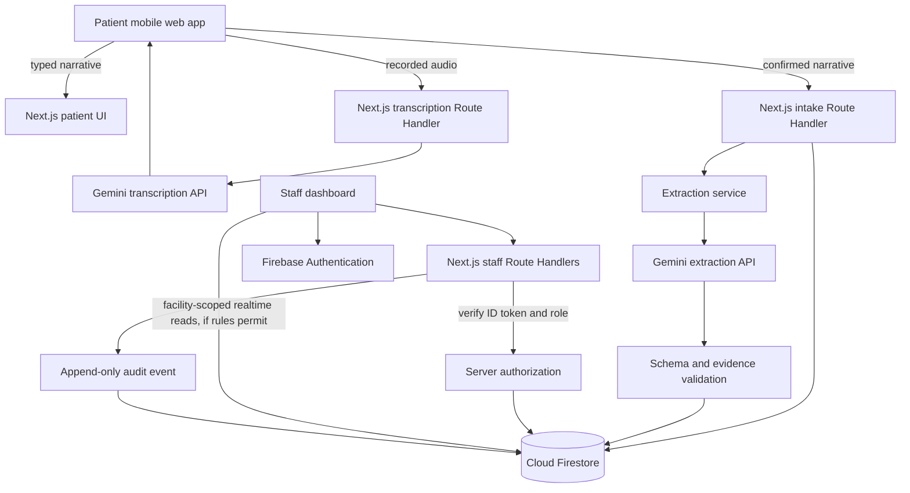

# MedFlow — Technical Architecture (Hackathon Baseline)

## 1. Architecture objective

Build a small, understandable full-stack **Next.js application** that supports the patient-to-clinician workflow, can be inspected in GitHub and can be deployed reliably. Keep the design commercially sensible without introducing microservices or unnecessary infrastructure.

## 2. Approved technology decisions

The application framework is **Next.js with the App Router**. This is an explicit project requirement, not an optional recommendation.

| Layer | Approved choice | Implementation boundary |
|---|---|---|
| Framework | **Next.js App Router** | One Next.js application; do not replace with Vite, plain React, or a separate Express app. |
| Language | TypeScript | Strict types for domain objects, API contracts and service boundaries. |
| UI | React Server and Client Components | Use Client Components only where browser interaction/state is required. |
| Styling | CSS using the approved design-system tokens | Preserve the HTML/CSS reference; do not introduce an unapproved visual system. |
| Server/API | **Next.js Route Handlers** under `app/api/**/route.ts` | No separate Express or Python backend for the MVP. |
| Authentication | Firebase Authentication | Staff identity is verified server-side for protected operations. |
| Database/realtime | Cloud Firestore | Facility-scoped records; restrictive Security Rules; realtime listeners only where needed. |
| Privileged database access | Firebase Admin SDK from server-only modules, **only after runtime compatibility is proven** | Never expose service credentials or Admin SDK in browser bundles. |
| AI extraction | Google Gemini API, called server-side | Strict schema validation; AI output is a non-authoritative draft. |
| Voice transcription | Gemini audio transcription through the currently supported official API/model | Verify exact model ID, API, audio format and limits from current official docs before implementation. |
| Validation | Zod or equivalent | Validate every untrusted request and model response at runtime. |
| Tests | Unit and integration tests; add browser-level tests for critical flows | Test business rules and failure states, not only component rendering. |
| Deployment target | Google Cloud Run or another verified Node.js host that supports the selected Next.js features | Confirm the actual build and runtime configuration before claiming deployment readiness. |

Do not silently change this stack. If a chosen platform cannot run the required Next.js App Router application or a required server capability, stop and report the exact incompatibility and options. Do not quietly substitute Vite/React, client-only Firebase writes, another backend framework or a different database. Any change requires founder approval and a corresponding documentation decision.

## 3. Google AI Studio and Next.js setup

Google AI Studio Build supports **Next.js** in addition to React and Angular. Google's March 18, 2026 announcement says to select the desired framework from the updated Settings panel. MedFlow must use that selector to choose **Next.js**; do not leave the project on the React default.

Official confirmation: https://blog.google/innovation-and-ai/technology/developers-tools/full-stack-vibe-coding-google-ai-studio/

Before implementation, the agent must:

1. Confirm the imported workspace is in Build Mode and its framework setting is **Next.js**.
2. Inspect the repository. The current GitHub repository is a documentation/design-system baseline; it intentionally does not yet contain an application scaffold or `package.json`.
3. Initialise the application as a genuine Next.js App Router + TypeScript project, preserving all existing project documentation and design-system files.
4. Verify the project uses Next.js scripts/dependencies and App Router files, and that the Build preview executes the Next.js app rather than a plain React/Vite scaffold.
5. Verify Next.js Route Handlers, server-only environment secrets and Node.js runtime behaviour in the actual workspace before relying on them.
6. Verify Firebase Authentication token verification and the Firestore server access pattern in Preview and the intended deployment environment.
7. Record verified setup decisions, any remaining limitations and test evidence in the sprint log.

If the Next.js option is missing from the framework selector or the imported workspace fails to run a genuine Next.js application, report the exact observed limitation and stop before replacing the framework. Do not silently substitute Vite/plain React or create a separate Express/Python backend. Any stack change requires founder approval and a corresponding documentation decision.

The fact that AI Studio offers a server-side Node.js runtime and Firebase integration does not, by itself, prove that every Next.js server feature or Firebase Admin SDK operation works in Preview. Test the specific capabilities used by MedFlow rather than making assumptions.

Official technical references:
- Google AI Studio Build Mode: https://ai.google.dev/gemini-api/docs/aistudio-build-mode
- Google announcement of Next.js support: https://blog.google/innovation-and-ai/technology/developers-tools/full-stack-vibe-coding-google-ai-studio/
- Next.js App Router: https://nextjs.org/docs/app
- Next.js Route Handlers: https://nextjs.org/docs/app/getting-started/route-handlers
- Firebase Admin SDK: https://firebase.google.com/docs/admin/setup
- Firestore Security Rules: https://firebase.google.com/docs/firestore/security/get-started

## 4. Application structure

Use the Next.js App Router. The exact layout may evolve, but keep the following responsibilities clear:

```text
src/
  app/
    (patient)/
      intake/
        page.tsx
    (staff)/
      staff/
        page.tsx
        intakes/[intakeId]/page.tsx
    api/
      intakes/route.ts
      intakes/transcribe/route.ts
      intakes/[intakeId]/extract/route.ts
      staff/intakes/route.ts
      staff/intakes/[intakeId]/review/route.ts
      staff/intakes/[intakeId]/brief-review/route.ts
      staff/intakes/[intakeId]/priority/route.ts
      staff/intakes/[intakeId]/status/route.ts
    layout.tsx
    globals.css
  components/
    patient/
    staff/
    shared/
  features/
    intake/
    transcription/
    extraction/
    queue/
    audit/
  lib/
    firebase/
      client.ts
      admin.ts
    auth/
    schemas/
    services/
    utils/
  styles/
    design-tokens.css
tests/
  unit/
  integration/
  e2e/
```

This is a responsibility map, not a requirement to create empty folders. Keep route handlers thin and move business logic into testable services. Keep Firebase Admin imports in server-only modules. Never import server modules into Client Components. Do not create a separate `server/` Express application.

## 5. Logical architecture



The diagram describes logical responsibilities. Keep the MVP as one Next.js deployment and one Firestore project. Do not introduce a message broker, vector database, external analytics system or microservice.

## 6. Authentication, authorization and Firestore

- Firebase Authentication establishes staff identity; it does **not** by itself establish facility membership or staff role.
- Protected Route Handlers must verify the Firebase ID token on the server and resolve the staff profile, active status, allowed facilities and role from trusted server-side data.
- Derive `facilityId` from the verified staff membership. Never trust a client-supplied facility ID as proof of access.
- Use Firebase Admin SDK only in server-only modules and only after confirming it works in the actual Next.js runtime and deployment target.
- Firestore Security Rules must deny broad public reads and writes. Public patient intake may create only the narrow data shape required by the approved flow; patients must not read other intakes or write staff-only fields.
- If the staff dashboard uses Firestore realtime listeners from the browser, use Firebase client SDK and Security Rules for those reads. Scope every query to facilities the authenticated staff member is authorised to access. Do not expose Admin credentials to enable realtime updates.
- If AI Studio Preview cannot support Admin SDK, do not work around that limitation by granting broad client writes or trusting the browser. Report the limitation and use a verified compatible Next.js runtime or wait for approval.
- Audit events are append-only from the application perspective. Ordinary clients cannot create arbitrary audit entries, edit them or delete them. Trusted server operations create events alongside the state change, ideally in one Firestore transaction or batch.
- A single preconfigured synthetic demo facility is sufficient for the hackathon, but preserve facility scoping in the data model.

## 7. Data-flow rules

1. Patient enters typed text or records audio after explicit microphone permission and disclosure.
2. Audio is sent to the Next.js transcription Route Handler after an explicit user action. Process it transiently; do not persist raw audio.
3. Return a transcript draft. Patient can review, edit, re-record or use typed fallback, then explicitly confirm the narrative.
4. Persist the intake before starting AI extraction. Use an idempotency key to prevent duplicate records.
5. A server-side extraction service calls Gemini and validates the result against the versioned schema.
6. Store the original confirmed narrative and AI draft separately. Never overwrite the patient's words.
7. Evidence references must resolve to exact source text or stable transcript spans. Mark missing, unclear and conflicting information explicitly.
8. AI cannot set priority, workflow status, diagnosis or treatment.
9. Staff dashboard reads only the authenticated staff member's facility-scoped queue.
10. Staff reviews/corrects the draft and assigns priority/status. The server validates permission, state transition and reason, then records an audit event.
11. If AI or transcription fails, preserve the intake and surface it to staff with a visible failure/needs-review state.

## 8. API boundaries

Implement the API contracts in `docs/09_DATA_MODEL_AND_API_CONTRACTS.md` as Next.js Route Handlers:

- `POST /api/intakes`
- `POST /api/intakes/transcribe`
- `POST /api/intakes/[intakeId]/extract`
- `GET /api/staff/intakes`
- `POST /api/staff/intakes/[intakeId]/review`
- `POST /api/staff/intakes/[intakeId]/brief-review`
- `POST /api/staff/intakes/[intakeId]/priority`
- `POST /api/staff/intakes/[intakeId]/status`

Route Handlers validate request bodies, authenticate/authorise protected actions, call domain services and return safe response shapes. Do not expose provider errors, stack traces, credentials or database internals. Use the Web Request/Response APIs supported by Next.js Route Handlers. Do not create a parallel Express API.

## 9. Reliability and queue behaviour

- Apply request size, duration and MIME-type limits to audio.
- Use bounded timeouts and retries for provider calls.
- Persist intake before AI processing.
- Make AI processing state visible and recoverable.
- Use idempotency for intake creation and safe bounded retries for extraction.
- Avoid duplicate records when a mobile client retries.
- Keep unassigned priority explicitly visible; never treat it as low priority.
- Sort the active queue deterministically by staff-assigned priority rank, submission timestamp (oldest first), then stable document ID.
- Do not let model output alter queue order or priority.

## 10. Deployment and secrets

- Keep Gemini API keys and Firebase Admin credentials in server-side environment secrets.
- Use AI Studio's server-side secret mechanism only if verified for the selected Next.js execution path.
- Include `.env.example` with names and safe placeholders only. Never commit `.env`, service-account keys, tokens or credentials.
- Verify the chosen Next.js hosting target supports the App Router, Route Handlers, required Node APIs and server-side environment variables.
- Cloud Run is a candidate deployment target, not a claim of completed deployment. Verify the actual build/start commands and runtime.
- Confirm the deployed origin uses HTTPS for microphone access.
- Add the microphone permission declaration to `metadata.json` if required by the current AI Studio Build environment.
- Test the deployed URL on a real target Android phone/browser.

## 11. Build verification

Before calling the architecture implemented, verify:

- The project is genuinely Next.js App Router (including `next` dependency, `app/` routes and working Next.js scripts).
- A production build completes.
- At least one Next.js Route Handler runs in the target environment.
- Firebase ID token verification and facility/role authorization work server-side.
- Firestore access is appropriately restricted and tested.
- Gemini requests execute server-side with secrets unavailable to the browser.
- Voice capture/transcription, transcript confirmation and typed fallback work end-to-end.
- Failure paths preserve intake data and staff visibility.
- The critical tests in `docs/10_TESTING_AND_DEMO_PLAN.md` pass.

A React interface generated by AI Studio is not evidence that the Next.js architecture has been implemented.
