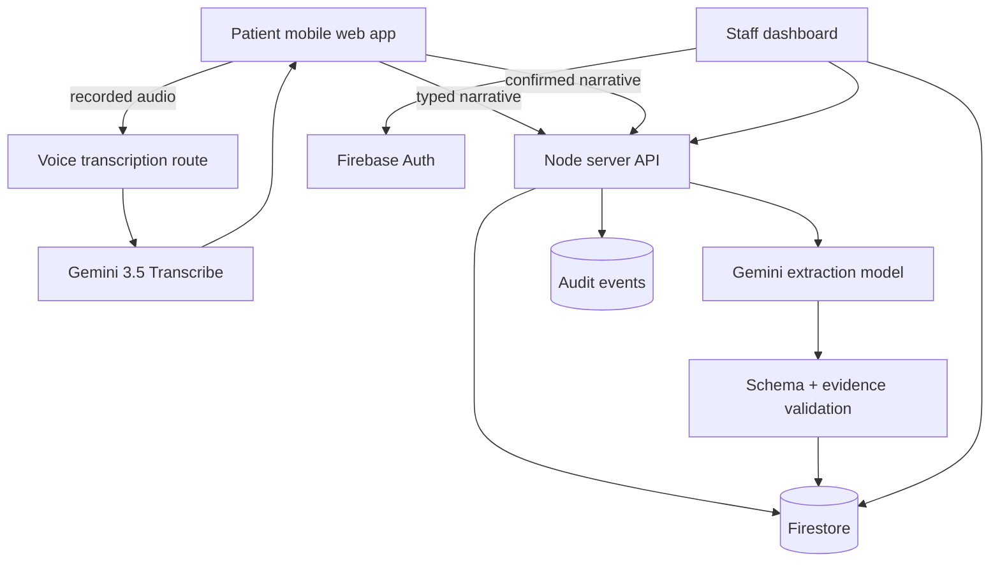

# MedFlow — Technical Architecture (Hackathon Baseline)

## 1. Architecture objective

Build a small, understandable full-stack web app that is deployable from Google AI Studio Build Mode, can be inspected in a public GitHub repository and demonstrates a coherent patient-to-clinician workflow. Avoid microservices and unnecessary infrastructure.

## 2. Proposed stack

The final stack must be confirmed against the actual generated project and current Google AI Studio Build support. Recommended baseline:

- Frontend: React + TypeScript.
- Styling: design-system tokens and reusable components from the approved HTML reference, adapted into React components.
- Server: Node.js server routes in the AI Studio full-stack environment.
- Authentication: Firebase Authentication for staff; consider Firebase Anonymous Authentication for a narrow public patient-intake session if required by the final rules design.
- Database/realtime: Cloud Firestore through the Firebase Web SDK in AI Studio Preview, protected by strict Firestore Security Rules.
- AI narrative extraction: server-side Gemini model through the official supported SDK/API.
- Voice transcription: server-side `gemini-3.5-transcribe` prerecorded audio flow via the currently documented Interactions API, after verifying exact SDK/API support in the selected runtime.
- Validation: Zod or equivalent runtime schema validation.
- Testing: unit and integration tests for deterministic business logic and API validation.
- Deployment: Google AI Studio supported deployment path, such as Cloud Run, after verifying generated configuration.

Do not add a separate queue service, vector database, external analytics system or microservice for the hackathon MVP.

## 3. Logical components



The diagram describes logical flow; the implementation can use a single server and a small number of routes. In the current AI Studio Preview support guidance, Firebase Admin SDK Firestore calls are reported as unsupported; Google support recommends the Firebase Web SDK plus Firestore Security Rules for Preview. Therefore, do not assume a server-side Admin SDK database design will work in Preview. Validate the actual app environment before committing to any privileged server-side Firestore operation. Gemini API calls remain server-side.

## 4. Data-flow rules

1. Patient can create a new intake without seeing any other records.
2. Patient client validates the form and creates an intake through the Firebase Web SDK under restrictive Firestore rules (or through a separately verified trusted backend if Preview supports it); the record is created before AI extraction.
3. Audio is sent only to the server transcription endpoint after explicit patient action and disclosure.
4. Raw audio is processed transiently and not persisted by MedFlow.
5. Patient reviews and confirms transcript.
6. Confirmed narrative is persisted through an authorised, facility-scoped operation.
7. Server calls Gemini extraction and validates the model response.
8. The validated extraction is stored separately from the original narrative. If the Preview-compatible architecture requires client-mediated persistence, the result remains explicitly an untrusted AI draft until a staff member confirms it; do not imply cryptographic or server-enforced provenance that is not implemented.
9. Staff dashboard listens to the facility-scoped queue.
10. Staff review/priority changes are enforced by authenticated identity, roles and Firestore rules, and create append-only audit events. Prefer an atomic transaction for the intake update and audit event where supported.

## 5. Suggested source layout

Adapt to the generated project, but preserve conceptual separation:

```text
src/
  app/
  components/
    patient/
    staff/
    shared/
  features/
    intake/
    transcription/
    extraction/
    queue/
    audit/
  lib/
    firebase-client.ts
    api-client.ts
    schemas/
  styles/
server/
  routes/
    transcribe.ts
    intakes.ts
    extraction.ts
    staff-actions.ts
  services/
    transcription.service.ts
    extraction.service.ts
    audit.service.ts
  middleware/
  validators/
  config/
shared/
  contracts/
  types/
tests/
  unit/
  integration/
```

Do not expose server files or secrets in a client bundle. If AI Studio generates a different layout, document the mapping in `docs/ARCHITECTURE.md` or this file rather than reshuffling folders unnecessarily.

## 6. Security and facility scoping

Every intake and audit event includes `facilityId`. Every staff query is scoped to the authenticated staff member's allowed facility. For MVP, a single preconfigured demo facility is sufficient, but do not hard-code a data model that assumes every future user can read every facility.

Use Firestore Security Rules to prevent unauthorised client access. Never rely solely on hiding buttons in the UI. Public intake writes must be narrow and validated. Staff read/update permission must be role-gated. Audit events should be created through a trusted backend where supported or via an explicitly constrained write rule/transaction that prevents modification or deletion after creation. Because AI Studio Preview has current limitations reported for Firebase Admin SDK use, AI Studio must prove the selected data-write pattern before implementing the full workflow. Never work around this by exposing privileged credentials.

## 7. Reliability

- Use server-side API calls for all Gemini requests.
- Apply request size/time limits to audio.
- Set timeouts and bounded retries.
- Use idempotency protection for intake creation.
- Persist intake before AI processing.
- Make AI processing status visible.
- Avoid duplicate records when a mobile client retries.
- Record safe error codes; do not leak stack traces or provider responses to patients.

## 8. Real-time queue

Use Firestore realtime listeners for the staff queue. Query by `facilityId` and active statuses, with the correct indexes. Sort client-side or server-side by an explicit, deterministic tuple:

1. staff-assigned priority rank;
2. submission timestamp, oldest first;
3. stable document ID as tie-breaker.

Unassigned priority must remain visible and cannot be represented as low priority. Show `Unassigned` explicitly.

## 9. Deployment

- Use server-side environment secrets.
- Include `.env.example` with variable names and safe placeholders only.
- Document setup, Firebase project config, Gemini secret and deployment steps.
- Never commit `.env`, service-account keys, private credentials, Firebase Admin credentials or real data.
- Confirm application origin uses HTTPS for microphone access.
- Add `microphone` to `requestFramePermissions` in `metadata.json` as required by current AI Studio Build guidance for microphone access.
- Test deployed URL on actual target Android phone/browser.

## 10. Build verification

AI Studio must inspect the current official Build Mode docs and generated project conventions before choosing packages or deployment commands. Current official entry point: https://ai.google.dev/gemini-api/docs/aistudio-build-mode. It describes server-side `GEMINI_API_KEY` secret injection, Build Mode microphone permission metadata, deployment to Cloud Run and GitHub sync. A November 2026 Google AI Studio support response says Firebase Admin SDK Firestore calls are not supported in Preview and recommends Firebase Web SDK plus Firestore Security Rules; verify the actual project behaviour before relying on this.
