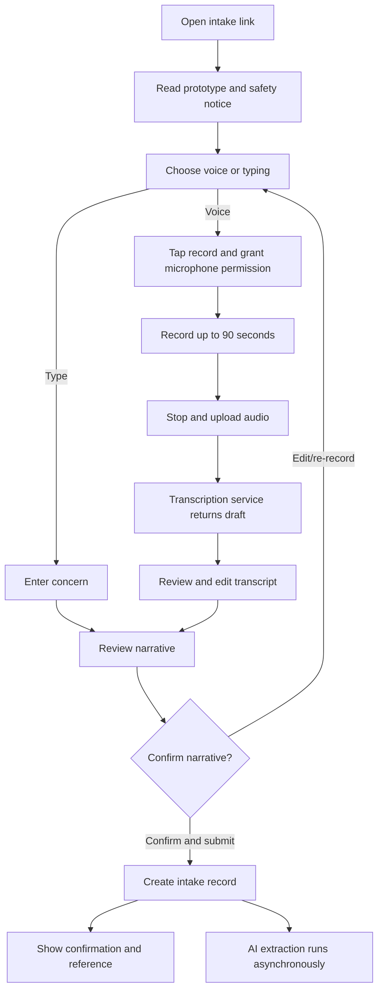
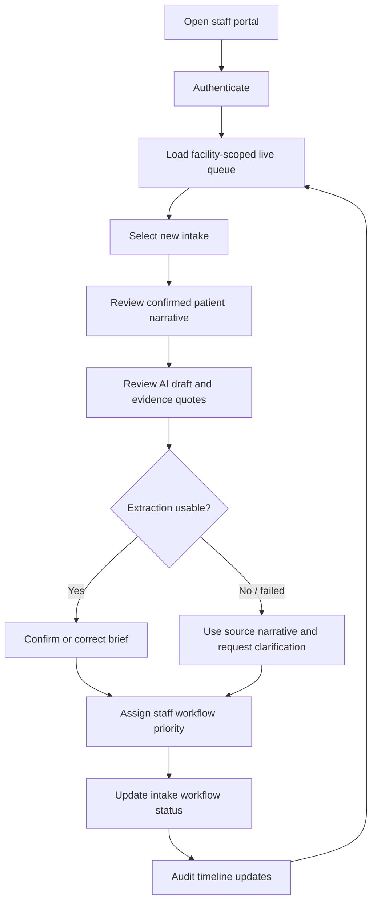

# MedFlow — UX, User Flows and Screen Specification

**Document ID:** MED-UX-014  
**Version:** 0.1  
**Status:** Hackathon design baseline — visual design is finalised in the separate HTML design system  
**Last updated:** 2026-11-21  
**Related PRD:** `13_PRODUCT_REQUIREMENTS.md`

---

## 1. UX objective

Make the patient intake experience calm, short and forgiving, while making the staff experience operationally clear and review-oriented.

The patient should be able to communicate a concern in their own words without needing to understand medical terminology. The staff member should be able to identify new intake records, inspect the source narrative, understand what the AI extracted, identify unknowns, make corrections and manage workflow priority/status.

The UX must never imply that an AI-generated summary is a diagnosis or that an AI result determines how urgently someone should receive care.

## 2. Experience principles

### 2.1 Patient experience

1. **One task per step:** avoid a long form with many unrelated questions.
2. **Voice is first-class:** voice and typing are equally visible choices; neither is hidden as an advanced option.
3. **User control:** no microphone activation, recording or upload without explicit user action.
4. **Review before send:** the patient sees the transcript and can correct it before submission.
5. **No silent loss:** typed text and completed transcript drafts should survive recoverable navigation/network errors where feasible.
6. **Safety before convenience:** the notice tells people not to wait for the form or AI response when immediate help is needed.
7. **Plain language:** avoid clinical jargon in patient-facing labels.

### 2.2 Staff experience

1. **Queue first:** the first staff screen makes incoming work visible immediately.
2. **Source beside summary:** original narrative and AI brief must be easy to compare.
3. **Uncertainty visible:** explicit, unclear and missing information use different labels.
4. **Human authority obvious:** labels say `AI draft` and `Staff-assigned`; never `AI priority`.
5. **Actions are auditable:** priority changes and corrections require reason/context.
6. **Density with legibility:** staff can scan many cases without tiny text, ambiguous colour-only status or decorative clutter.
7. **Responsive resilience:** dashboard is desktop-first but must remain usable on tablet-sized screens.

## 3. Information architecture

### 3.1 Public patient routes

- `/intake` — prototype notice and start of patient intake.
- `/intake/describe` — choose type or voice and enter concern.
- `/intake/review` — review/edit transcript or typed narrative before final submission.
- `/intake/submitting` — submission progress state.
- `/intake/confirmation` — intake reference and safety reminder.

Routes may be implemented as steps in a single-page flow if the state transitions and browser-back behaviour are reliable. Do not expose intake IDs as a way to read prior records.

### 3.2 Staff routes

- `/staff/login` — staff authentication.
- `/staff/queue` — real-time intake queue.
- `/staff/intakes/:intakeId` — intake detail/review view.

A detail drawer or side panel is acceptable instead of a separate route, provided deep links do not bypass authorisation. A demo reset view, if implemented, must be restricted to authorised staff and is not a required P0 screen.

## 4. Screen inventory

| ID | Screen | User | Priority | Purpose |
|---|---|---|---|---|
| PAT-01 | Intake start / notice | Patient | P0 | Explain demo limits and start intake. |
| PAT-02 | Describe concern | Patient | P0 | Select voice or typing and enter the narrative. |
| PAT-03 | Recording state | Patient | P0 | Control microphone capture and recording lifecycle. |
| PAT-04 | Transcript review | Patient | P0 | Edit, re-record and confirm transcript. |
| PAT-05 | Submission progress | Patient | P0 | Prevent duplicate submission and show state. |
| PAT-06 | Confirmation | Patient | P0 | Confirm successful intake and show reference. |
| STAFF-01 | Staff login | Nurse/doctor | P0 | Authenticate authorised staff. |
| STAFF-02 | Clinical command queue | Nurse/doctor | P0 | View live, facility-scoped intake records. |
| STAFF-03 | Intake detail / evidence review | Nurse/doctor | P0 | Compare source narrative and AI draft. |
| STAFF-04 | Staff correction | Nurse/doctor | P0 | Confirm or correct structured extraction. |
| STAFF-05 | Priority/status action | Nurse/doctor | P0 | Assign workflow priority and update status. |
| STAFF-06 | Audit timeline | Nurse/doctor | P0 | Inspect important changes. |
| STAFF-07 | Empty/loading/error states | Nurse/doctor | P0 | Communicate queue and service states. |
| STAFF-08 | Demo reset | Admin/provisioned staff | P1 | Restore synthetic demo dataset if safe. |
| STAFF-09 | Search/filter | Nurse/doctor | P1 | Find records and narrow queue. |
| STAFF-10 | Printable brief | Nurse/doctor | P1 | Print/export a reviewed intake brief. |

## 5. Patient journey — end-to-end

### 5.1 Flow overview

The UI must not make the patient wait for AI extraction before acknowledging a successfully created intake. A patient submission is considered received once the intake record is saved, not when Gemini finishes.

### 5.2 PAT-01 — Intake start / notice

**Purpose:** Explain what the prototype is and what it is not before any health narrative is collected.

**Required content:**
- Product name/working name.
- Short instruction: “Tell us what you are experiencing. You can type or speak.”
- Persistent demo notice: “DEMO ONLY — Do not enter real patient information.”
- Safety message: “MedFlow is not an emergency service or a diagnostic tool. If someone needs immediate help, alert hospital staff directly. Do not wait for this form or an AI response.”
- Primary action: `Start intake`.

**Behaviour:**
- Continue only after the user can see the notice.
- Do not ask for microphone permission on this screen.
- Do not show fictional hospital affiliation or certification.

**States:** initial, loading next step, navigation error.

### 5.3 PAT-02 — Describe concern

**Purpose:** Collect the minimum information needed to create an intake record.

**Fields:**
- `Name or alias` — optional; explain it is for staff to address the person in the demo.
- `Age` — optional numeric field if included in the implementation; validate sensible input bounds without forcing disclosure.
- `How can you describe what is happening?` — required narrative, with voice and typing as equal input choices.

**Input modes:**
- `Type my concern` — opens/focuses multiline text area.
- `Speak my concern` — opens voice recording controls.

**Behaviour:**
- A mode switch must preserve existing text. If switching from a transcript draft to typing, retain the transcript text.
- Do not clear text when the user taps back.
- Use helper copy such as: “Use your own words. You do not need medical terms.”
- Do not ask a patient to self-diagnose or select a disease.
- Do not use a model-generated urgency or symptom checklist on this screen.

**Validation:**
- Narrative is required.
- Apply a visible character limit consistent with server validation.
- Optional fields remain optional.
- If age field is omitted from the build for time, remove it from the UX and data contract rather than leaving an inert field.

### 5.4 PAT-03 — Recording state

**Purpose:** Capture an explicit, short audio statement.

**Entry action:** User taps `Start recording`.

**Permission flow:**
1. Request microphone permission only after the tap.
2. While permission is pending, show “Waiting for microphone permission”.
3. If denied, explain how to enable permission where appropriate and show `Type instead`.
4. If unsupported, show `Voice recording isn't available in this browser. Type instead.`

**Recording UI:**
- Large, unambiguous recording indicator.
- Text label `Recording` (do not rely on red colour alone).
- Elapsed time.
- `Stop recording` and `Cancel` controls.
- Maximum duration 90 seconds; stop automatically at limit and explain why.
- No hidden/background recording.

**After stop:**
- Show `Audio ready` and actions `Transcribe`, `Record again`, `Cancel`.
- The user explicitly starts transcription/upload.
- Do not upload on a stop event without the user's visible action if the UI design uses a separate preview step.

**Error cases:**
- Permission denied.
- No microphone found.
- Recorder unsupported.
- Recording interrupted by browser/OS.
- Empty/too-short clip.
- Upload too large or unsupported MIME type.
- Network failure.

In every failure state, preserve the option to type the concern.

### 5.5 PAT-04 — Transcript review

**Purpose:** Let the patient inspect the words that will be submitted.

**Required elements:**
- Label: `Transcript draft`.
- Editable multiline text area prefilled with transcription.
- Helper text: “Please correct anything the recording did not capture accurately.”
- Actions: `Use this transcript`, `Record again`, `Type instead`.
- Optional language indicator only if reliably returned by the transcription service; do not invent a language label.

**Behaviour:**
- Transcript is a draft, not a verified statement until patient confirmation.
- Patient may freely edit wording, punctuation and names.
- Do not rewrite or “improve” the transcript automatically after user edits.
- If the service returns an empty or nonsensical transcript, block confirmation and offer retry/type.
- On confirmation, preserve both raw transcription draft and final confirmed narrative where the chosen data model supports it.

### 5.6 PAT-05 — Submission progress

**Purpose:** Prevent duplicate submit and communicate persistence status.

**Behaviour:**
- Disable repeated submit while request is in flight.
- Use an idempotency key for safe retry.
- Show a calm progress state such as `Submitting your information…`.
- Do not state that a nurse has reviewed the case; no such event has occurred yet.
- If the request fails before persistence, preserve the narrative and offer retry.
- If persistence succeeded but AI extraction is still running, proceed to confirmation; do not hold the patient on this screen.

### 5.7 PAT-06 — Confirmation

**Required content:**
- Confirmation: `Your information has been submitted.`
- Generated intake reference.
- Reminder: `This is a demo intake record, not a clinical assessment. If you need immediate help or your condition worsens, alert hospital staff directly. Do not wait for an AI response.`
- Avoid promising a precise callback time or guaranteed treatment.

**Behaviour:**
- Do not expose a link to read or edit another intake.
- Do not display an AI urgency label.
- Do not say `You are safe to wait`, `A doctor will see you in X minutes`, or similar unsupported promises.

## 6. Staff journey — end-to-end

### 6.1 Flow overview

### 6.2 STAFF-01 — Staff login

**Purpose:** Restrict access to the queue and patient intake details.

**Required elements:**
- MedFlow working name/logo.
- Staff email/identifier and authentication controls supplied by configured auth provider.
- `Sign in` action.
- Clear authentication error.
- No public sign-up or self-service role assignment in P0.

**Behaviour:**
- Authenticated staff profile must be provisioned and linked to the demo facility.
- Role and facility access are checked by trusted rules/server logic.
- Never place demo passwords or service credentials in the public repository.
- After sign-in, redirect to `/staff/queue`.

### 6.3 STAFF-02 — Clinical command queue

**Purpose:** Provide an immediately understandable view of incoming intake records.

**Layout regions:**
1. **Top bar:** product identity, facility name, persistent `DEMO DATA` indicator, connection state, staff identity and sign out.
2. **Page heading:** `Clinical intake queue` with plain explanation that these are intake records awaiting staff review.
3. **Queue groups:** unassigned/new records first, followed by staff-assigned priority groups.
4. **Queue row/card:** generated reference, optional display name/alias, age if supplied, submitted time, input mode, AI extraction state, staff-assigned priority and workflow status.
5. **Selected record panel:** opens intake details without losing queue context.

**Default ordering:**
1. Unassigned / awaiting staff review.
2. Immediate review (staff-assigned).
3. Priority review (staff-assigned).
4. Routine review (staff-assigned).
5. Oldest submission first within each group.

This is an explicit workflow ordering rule. UI help text should state that it is not a validated clinical triage scale or treatment-time promise. The queue must keep all cases accessible and must not hide items with failed AI extraction.

**Recommended row hierarchy:**
- First line: reference + alias + current workflow state.
- Second line: short, staff-reviewed or source-grounded concern preview; do not expose a diagnosis.
- Metadata: time received, voice/typed, AI status.
- Priority chip: only when assigned by staff; unassigned is a first-class visible state.

**Real-time connection states:**
- `Live` — active listener connected.
- `Reconnecting` — connection interrupted; show last update time.
- `Offline` or `Connection unavailable` — do not represent stale data as live.

**Queue states:**
- Loading skeleton.
- Empty state with explanation and safe synthetic demo seed action if provided.
- Populated list.
- No results (P1 search/filter).
- Partial data/error state.
- Reconnecting/stale state.

### 6.4 STAFF-03 — Intake detail / evidence review

**Purpose:** Give staff enough context to verify the AI output against the patient statement.

**Layout regions:**
- Header: intake reference, DEMO DATA badge where applicable, received timestamp, workflow status, staff-assigned priority.
- Source panel: `Patient's confirmed words` with the exact confirmed narrative.
- AI panel: `AI-generated intake draft` with extraction status and schema version where useful.
- Evidence cards: each symptom/fact, certainty label and exact source quote.
- Missing/unclear section: information not stated or ambiguous.
- Staff review status: `Not reviewed`, `Confirmed by staff` or `Corrected by staff`.
- Action bar: `Confirm brief`, `Correct brief`, `Mark in review`, `Await clarification`, `Assign priority`.
- Audit timeline: chronological list of important events.

**Behaviour:**
- Source narrative remains visually distinct from generated summary.
- Every evidence quote is visibly connected to the extracted item.
- No AI-derived severity, diagnosis, risk colour or urgency badge appears.
- If AI extraction failed, source narrative remains available and the UI explains `AI summary unavailable`.
- If AI needs clarification, list that state without treating it as a clinical negative.

### 6.5 STAFF-04 — Staff correction

**Purpose:** Preserve human review and avoid silently treating AI draft as the final record.

**Minimum P0 interaction:**
- Staff can open an edit form for the structured intake brief.
- Editable fields are limited to extracted content: chief concern, symptom items, durations/severity where explicitly stated, relevant context, missing/unclear items and summary wording.
- Staff can add a correction note explaining the change.
- Save creates `staffReviewedBrief` separate from `aiBrief`.
- Original patient narrative and original AI draft remain visible/auditable.

**Confirmation action:**
- `Confirm as accurate` marks the AI brief as staff-reviewed without changing the content.
- `Save corrections` persists a reviewed copy and a reason/note.

**Behaviour:**
- Never silently overwrite model output.
- Never allow the model to set staff review state.
- Avoid presenting a staff edit as a diagnosis or protocol result.

### 6.6 STAFF-05 — Priority and status actions

**Priority control:**
- `Unassigned` (default; not a staff decision).
- `Immediate review`.
- `Priority review`.
- `Routine review`.

Display helper copy: `Workflow labels assigned by staff for queue organisation. They are not a validated clinical triage scale or a guarantee of treatment time.`

**Priority change flow:**
1. Staff selects a priority.
2. If first assignment, record the assigned value and actor; a reason may be requested by product policy.
3. If changing an existing assignment, require a reason.
4. Show a confirmation summary before saving if the control is high-impact or the change is from/to Immediate review.
5. Save through trusted API/rules and append audit event.
6. Queue ordering updates in real time.

**Workflow status control:**
- New.
- In review.
- Awaiting clarification.
- Completed (label in UI: `Intake review completed` where space permits).

Status changes follow the PRD state transition table. `Completed` does not mean treatment/discharge/clearance.

### 6.7 STAFF-06 — Audit timeline

**Purpose:** Let staff see what happened to the intake record.

**Each event shows:**
- Human-readable action.
- Actor display name/role if available.
- Timestamp in local timezone.
- Old → new value for priority/status changes.
- Reason/note when required.

Do not show raw audio, provider secrets, stack traces or unnecessary copies of patient narrative in the audit timeline.

## 7. UI state catalogue

### 7.1 Patient voice states

| State | User-facing copy / signal | Available actions |
|---|---|---|
| `idle` | `Ready to record` | Start recording; type instead |
| `requesting_permission` | `Waiting for microphone permission` | Allow/deny in browser; cancel; type instead |
| `permission_denied` | `Microphone access was blocked` | Try permission again where possible; type instead |
| `unsupported` | `Voice recording is not supported in this browser` | Type instead |
| `recording` | `Recording · 00:12` plus visible recording indicator | Stop; cancel |
| `recording_limit_reached` | `Recording stopped at the 90-second limit` | Transcribe; record again; type instead |
| `recording_stopped` | `Audio ready to transcribe` | Transcribe; record again; cancel |
| `uploading` | `Uploading audio securely…` | Avoid duplicate action; cancel if safely cancellable |
| `transcribing` | `Turning speech into editable text…` | Wait; cancel if safe |
| `transcript_review` | `Review your transcript` | Edit; use transcript; record again; type instead |
| `transcription_failed` | `We couldn't transcribe that recording` | Retry; re-record; type instead |
| `empty_transcript` | `No clear words were captured` | Re-record; type instead |
| `confirmed` | `Narrative confirmed` | Continue to submission |

### 7.2 Patient submission states

- `editing`: user can change content.
- `validating`: required fields being checked.
- `submitting`: request in progress; prevent duplicate tap.
- `saved`: intake record exists; may proceed to confirmation.
- `failed_before_save`: narrative preserved; retry available.
- `confirmation`: show reference and safety reminder.

If the server has already created the intake and the AI call is still pending, treat the patient submission as saved. Do not show submission failure merely because AI extraction is delayed.

### 7.3 AI extraction states

| Internal state | Staff label | Behaviour |
|---|---|---|
| `queued` | Waiting for AI summary | Source narrative visible |
| `processing` | Preparing intake summary | Source narrative visible; no blocking |
| `succeeded` | AI draft ready · Needs staff review | Show draft and evidence |
| `failed` | AI summary unavailable | Show source; allow staff to continue manually |
| `needs_human_clarification` | More information needed | Show unclear items; staff may ask for clarification |

### 7.4 Staff queue states

- `loading`: skeleton rows; preserve page layout.
- `empty`: clear explanation; optional synthetic demo-data seed action only if authorised.
- `live`: display last update/connection signal.
- `reconnecting`: amber/text state and last successful update time.
- `offline`: clear warning that queue is not live; retry control.
- `error`: safe error message and retry.
- `populated`: normal queue.

### 7.5 Staff action states

- `idle`.
- `saving` — disable duplicate action.
- `saved` — small confirmation and refreshed timeline.
- `validation_error` — identify missing reason or invalid transition.
- `permission_error` — explain that the account cannot perform this action.
- `network_error` — retain entered reason/corrections and allow retry.

## 8. Interaction rules

1. All primary controls must be functional; do not create inert buttons.
2. Destructive/reset controls require explicit confirmation and appropriate role.
3. Do not use colour alone for urgency, extraction status or workflow state. Pair colour with visible text and/or icon.
4. Do not use flashing/pulsing emergency-style effects for AI-extracted content.
5. Motion must be subtle, purposeful and reduced when the operating system requests reduced motion.
6. Form errors appear beside the relevant field and in an accessible summary when needed.
7. Preserve user-entered data after retryable failures.
8. Use clear date/time formatting and identify the timezone if showing timestamps in a cross-location context.
9. A patient cannot navigate from the confirmation screen to another patient's intake.
10. A staff member's access to detail routes must be re-authorised on every load, not trusted from a prior client state.
11. AI content is always visibly labelled as generated draft until staff review.
12. Staff edits must create a new reviewed copy rather than overwriting source or original AI output.
13. If a live queue connection drops, do not show a false `Live` indicator.

## 9. Responsive behaviour

### Patient interface

- Mobile-first; design for narrow Android screens before desktop.
- Main form uses a single-column layout.
- Voice controls and primary actions fit within the viewport without horizontal scrolling.
- Use large, clearly labelled touch targets.
- Keep the current step and progress understandable without relying on complex navigation.
- Keyboard opening must not hide primary actions entirely; allow scrolling to the submit/continue action.

### Staff interface

- Desktop-first with a queue/detail split view where space permits.
- On tablet/narrower widths, queue and detail become sequential screens or a responsive drawer.
- Queue rows retain reference, workflow status, priority and extraction status at all supported widths.
- Do not compress text to unreadable sizes to preserve a dense desktop layout.
- The staff interface must remain functional with keyboard navigation.

## 10. Accessibility requirements

- Use semantic headings, buttons, labels and form controls.
- Associate input labels and error messages programmatically.
- Show visible keyboard focus.
- Recording state must be conveyed textually; colour/animation is supplementary.
- Provide meaningful labels for icon-only controls; prefer text labels for microphone, stop and retry actions.
- Use sufficient contrast for text and status indicators.
- Respect reduced-motion preference.
- Never auto-play audio.
- Do not rely on hover alone to reveal important actions or information.

## 11. Content and microcopy standards

### Tone

- Calm, concise, respectful and plain-language.
- Avoid alarmist statements and exaggerated promises.
- Do not use diagnostic language in the patient UI.
- Avoid claims such as `AI knows what's wrong`, `emergency detected`, `you're safe`, `instant diagnosis` or `doctor will attend in X minutes`.

### Approved draft copy

**Patient notice:**

> DEMO ONLY — Do not enter real patient information. MedFlow is a demonstration prototype, not an emergency service or diagnostic tool. If someone needs immediate help, alert hospital staff directly. Do not wait for this form or an AI response.

**Intake prompt:**

> What are you experiencing? Use your own words. You can type or speak; you do not need medical terms.

**Voice button:**

> Start recording

**Transcript helper:**

> Please correct anything the recording did not capture accurately. This is the text that will be submitted.

**Submission confirmation:**

> Your information has been submitted. Your reference is [REFERENCE]. This is a demo intake record, not a clinical assessment. If you need immediate help, alert hospital staff directly.

**Staff AI label:**

> AI-generated intake draft — review against the patient's original words.

**Staff priority label:**

> Staff-assigned workflow priority. These labels are for queue organisation and are not a validated clinical triage scale or treatment-time promise.

**AI failure:**

> AI summary unavailable. The original patient statement is still available for staff review.

## 12. Demo experience and judge narrative

The product should support one coherent five-minute demo flow using only synthetic patient data.

1. Show the patient landing notice and explain the local communication problem.
2. Start voice recording on the target phone/browser and speak a prepared synthetic example.
3. Show the transcript returned by the speech service.
4. Correct one deliberately seeded transcription detail to demonstrate patient control.
5. Confirm and submit; show the generated intake reference.
6. Switch to the staff dashboard and show the record appear without a page refresh.
7. Open the intake and compare confirmed source narrative to AI-generated evidence-linked brief.
8. Confirm or correct the brief as staff.
9. Assign a staff workflow priority and update status.
10. Show the audit timeline and explain that AI never assigns clinical priority.
11. Briefly show typed fallback or AI failure handling if time allows.
12. Close with architecture, local problem relevance and next validation steps.

The demo must show actual running functionality. If microphone capture, transcription, live sync or any other feature is simulated, disclose that clearly and do not present it as a working integration.

## 13. Design-system handoff requirements

The standalone HTML design system must implement reusable foundations and components for:

- Patient form shell and step progression.
- Text input, textarea and optional age input.
- Voice recorder states: idle, permission, recording, stopped, transcribing, transcript review and failure.
- Submission/confirmation states.
- Staff shell, top navigation and connection state.
- Queue groups and queue rows/cards.
- AI extraction state labels.
- Evidence-linked fact cards and quote blocks.
- Explicit / unclear / missing labels.
- Staff-reviewed versus AI-draft states.
- Priority selection and reason dialog.
- Workflow status control.
- Audit timeline.
- Loading, empty, reconnecting, offline and error states.
- Responsive layout behaviour and accessibility states.

The HTML is a design reference, not the production app. It must use synthetic sample content and must not imply that any integration is already working.

## 14. UX acceptance checklist

### Patient
- [ ] Notice is visible before data entry.
- [ ] Patient can type without microphone permission.
- [ ] Patient can request voice permission explicitly.
- [ ] Recording state is obvious and has stop/cancel controls.
- [ ] 90-second recording limit is handled.
- [ ] Transcript is editable.
- [ ] Patient must confirm before submitting.
- [ ] Text is preserved through voice failure and retry.
- [ ] Submission confirmation appears after persistence, not after AI completes.
- [ ] No diagnosis, urgency advice or safe-to-wait language appears.

### Staff
- [ ] Authentication required.
- [ ] Facility-scoped queue loads.
- [ ] Live connection state is accurate.
- [ ] New/unassigned cases are visible first.
- [ ] Source narrative and AI brief are distinguishable.
- [ ] Quotes/evidence are connected to extracted items.
- [ ] Missing/unclear facts remain explicit.
- [ ] AI failure does not hide the intake.
- [ ] Staff can confirm/correct brief while preserving original AI result.
- [ ] Staff priority is clearly staff-assigned.
- [ ] Priority changes require reason and are audited.
- [ ] Status transitions are enforced and audited.
- [ ] Audit timeline is readable.
- [ ] All UI states and actions work on target viewport sizes.

## 15. Dependencies and open design decisions

- The actual voice recording/transcription endpoint must be validated on the selected Android browser before finalising recorder implementation details.
- AI extraction fields and evidence schema must match `06_AI_EXTRACTION_SPEC.md` and `09_DATA_MODEL_AND_API_CONTRACTS.md`.
- Staff-reviewed corrections require a separate persisted version; do not overwrite the original `aiBrief`.
- Final type, colour, icon and spacing tokens will be set in the standalone HTML design system. This document defines behaviour and information hierarchy, not final visual styling.
- Product name remains a codename until clearance.
